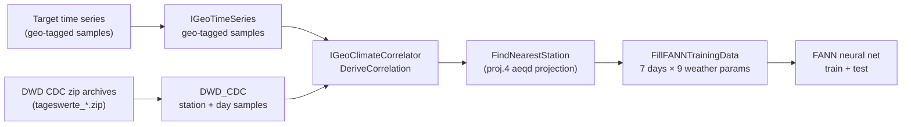

# Nachtigall

Geospatial and meteorological predictive modeling — Forecasting of weather dependent factors.

## What this project is

Nachtigall (German for "nightingale", a play on the project name *N8igall*) is a C++
library that learns the correlation between **local weather** and a **weather-dependent
time series at an arbitrary geographic location**. Given a target location and its
historical values, it:

1. Finds the nearest official weather station (Deutscher Wetterdienst, DWD).
2. Feeds a window of that station's historical weather observations into a neural
   network (FANN) together with the target values.
3. Trains the network to predict the weather-dependent value from the surrounding
   weather.

In short: **predict weather-dependent quantities from historic weather station data
using a neural network, anchored to a geo-coordinate.**

## How it works (pipeline)



1. **Target time series** — `IGeoTimeSeries` stores dated `ISample`s for a given
   longitude/latitude (see [src/n8igall.h](src/n8igall.h)).
2. **Weather data ingestion** — `DWD_CDC` ([src/utils/DWD_CDC.h](src/utils/DWD_CDC.h))
   reads the DWD Climate Data Center historic archive: it scans
   `tageswerte_<station>_<from>_<to>_hist.zip` files, extracts the daily climate
   product (`produkt_klima_Tageswerte_*.txt`) and station metadata via minizip, and
   parses them with `fast-cpp-csv-parser` into per-station `map<dayPoint, DaySample>`.
3. **Nearest station lookup** — `GeoClimateCorrelator::FindNearestStation` uses
   **proj.4** with an Azimuthal Equidistant projection centered on the target point so
   distances are measured without projection distortion, then picks the closest DWD
   station.
4. **Training data assembly** — for each valid day, a feature vector of
   `7 days × 9 weather parameters` (cloud cover, sunshine duration, max/min temp,
   precipitation, snow depth, relative humidity, wind speed, max gust) is built from a
   −4…+2 day window around the target day; days with missing values (`-999`) are
   skipped.
5. **Neural network** — a 3-layer **FANN** network (input → hidden → output, linear
   output layers) is trained on data up to 2014-12-31 and tested on the remainder,
   printing reference vs. predicted values and MSE.

## Public API (src/n8igall.h)

| Interface | Purpose |
|---|---|
| `ISample` | A (possibly multi-dimensional) value at one time point |
| `IGeoTimeSeries` | Time series of samples bound to a lon/lat coordinate |
| `IGeoClimateCorrelator` | Finds the nearest weather station and derives the correlation |
| `IGeoTimeSeriesClimateCorrelation` | Result handle of a derived correlation (currently a stub) |

## Third-party dependencies (vendored in `3rdparty/`)

| Library | Role |
|---|---|
| [FANN](3rdparty/fann) | Fast Artificial Neural Network library — the predictor |
| [proj.4](3rdparty/proj.4) | Geodesy: nearest-station search via projection |
| [zlib + minizip](3rdparty/zlib) | Extracting DWD's zipped climate archives |
| [fast-cpp-csv-parser](3rdparty/fast-cpp-csv-parser) | Parsing DWD CSV/TXT products |
| [date](3rdparty/date) | `dayPoint` calendar date handling (Howard Hinnant's date lib) |

## Building

Requires CMake ≥ 3.3 and a C++11 compiler.

```sh
./CreateProjectFiles.sh   # or: mkdir build && cd build && cmake ..
cd build
make -j$(nproc)
```

Outputs go to `bin/` (executables) and `build/src/libn8igall.so` (shared library).

## Project status / known TODOs

- Early-stage prototype (see [git history](../../commits)): API stubs, hardcoded paths
  (`../../test/data/`) and a hardcoded train/test split date — both marked `TODO` for
  configuration via libconfig.
- `IGeoTimeSeriesClimateCorrelation` is a placeholder; `DeriveCorrelation` returns `NULL`
  after running the train/test cycle inline.
- `iowin32.c` (minizip) is only compiled on Windows.
