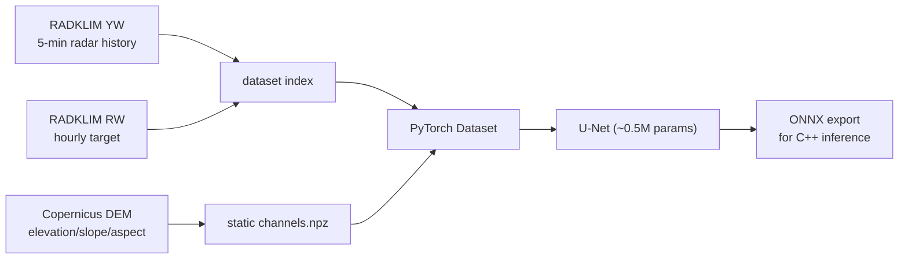

# Nachtigall MVP — +60 min precipitation nowcast

Trains a compact U-Net to predict radar-derived precipitation (RW, mm/h) 60
minutes ahead from recent RADOLAN YW radar history plus static terrain
channels. See [`../docs/rain-radar-nowcasting-research.md`](../docs/rain-radar-nowcasting-research.md)
for the research behind this design.

## Pipeline



## Layout

| Path | Purpose |
|---|---|
| `n8igall_mvp/grid.py` | RADOLAN grid definitions (classic 900×900 + ODIM HDF5) |
| `n8igall_mvp/radolan.py` | Readers for classic binary and ODIM HDF5 composites |
| `n8igall_mvp/download_radolan.py` | RADKLIM YW/RW downloader (recent + reproc archives) |
| `n8igall_mvp/dataset.py` | Sample index builder (history → +60 min target pairs) |
| `n8igall_mvp/dem.py` | Copernicus DEM → static channels on the RADOLAN grid |
| `n8igall_mvp/model.py` | Compact U-Net, weighted loss, CSI metric |
| `n8igall_mvp/train.py` | Training loop with persistence-baseline evaluation |
| `n8igall_mvp/export_onnx.py` | ONNX export + onnxruntime parity check |

## Usage

```sh
# 1. data (RADKLIM archives, free, no registration)
python3 -m n8igall_mvp.download_radolan --product yw --start 2025-04-01 --end 2025-04-30
python3 -m n8igall_mvp.download_radolan --product rw --start 2025-04-01 --end 2025-04-30

# 2. static terrain channels (Copernicus DEM from AWS mirror)
python3 -m n8igall_mvp.dem

# 3. sample index (4 x 30-min history -> RW at +60 min)
python3 -m n8igall_mvp.dataset --yw-dir data/raw/yw --rw-dir data/raw/rw \
    --start 2025-04-01T00:00 --end 2025-05-03T23:00 --out data/index.json

# 4. train (evaluates CSI vs persistence baseline each epoch)
python3 -m n8igall_mvp.train --index data/index.json --out runs/v1 \
    --epochs 15 --static data/static/channels.npz

# 5. export for C++ inference
python3 -m n8igall_mvp.export_onnx --checkpoint runs/v1/best.pt --out runs/v1/model.onnx
```

## Design notes

* **Inputs**: `log1p(rate)` of 4 YW frames at 30-min spacing (900×900) +
  4 static channels (normalized elevation, slope, sin/cos aspect).
* **Target**: RW hourly accumulation valid over `(t, t+60 min]`, converted to
  mm/h; invalid/clutter pixels masked out of the loss.
* **Loss**: MSE on `log1p` rates with 5× weight on pixels > 0.1 mm/h to
  counter the extreme class imbalance (most pixels are rain-free).
* **Metrics**: CSI at 0.1/1/5 mm/h vs. a persistence baseline (last radar
  frame as prediction).
* **Next inputs** (per research doc §4.4): ICON-D2 wind fields + derived
  orographic upslope/convergence features.

## Results

### Spacing A/B test (Jun–Sep 2024, 2,926 samples, full channels)

Same period, same seeds, same 80/20 chronological split, same 10 epochs,
same channels (radar + elevation/slope/aspect + ERA5 wind incl. upslope and
divergence). Only the input spacing differs; both windows span 90 minutes.

Best-epoch CSI@1.0 per run (3 seeds each):

| Config | Input | Channels | seed 0 | seed 1 | seed 2 | mean ± std |
|---|---|---|---|---|---|---|
| A: 30-min spacing | 4 frames | 14 | 0.101 | 0.118 | 0.119 | 0.113 ± 0.008 |
| **B: 5-min spacing** | 19 frames | 29 | **0.121** | **0.125** | 0.119 | **0.121 ± 0.003** |

Per-threshold means over the 3 seeds (B config): CSI@0.1 = 0.138 ± 0.001,
CSI@1.0 = 0.121 ± 0.003, CSI@5.0 = 0.001 ± 0.001. Persistence CSI@1.0 = 0.001.

**Verdict: 5-min spacing wins** — higher mean CSI@1.0 (+0.008 absolute, +7%
relative), never loses across seeds (2 wins, 1 tie), and is notably more
*stable* (std 0.003 vs 0.008). This matches the aliasing argument: 30-min
steps move convective cells 20–30 km on a 1 km grid; 5-min steps keep
displacement at 3.5–5 km. Both configs beat persistence ~100× at ≥1 mm/h.

Open weaknesses visible in both configs: CSI@5.0 ≈ 0 (heavy-rain events are
essentially missed) and CSI@0.1 ≈ 0.14 (light rain, largely below the
persistence baseline) — the model is tuned toward the 1 mm/h middle ground.

### Earlier experiments (Apr–May 2025, radar-only, 763 samples)

| Config | CSI@0.1 | CSI@1.0 | CSI@5.0 | persistence CSI@1.0 |
|---|---|---|---|---|
| radar-only (seed 0) | 0.033 | 0.297 | 0.126 | 0.010 |
| radar-only (seed 1) | 0.152 | 0.304 | 0.121 | 0.010 |
| +elevation (seed 0) | 0.042 | 0.154 | 0.077 | 0.010 |
| +elevation (seed 1) | 0.039 | 0.304 | 0.133 | 0.010 |

Takeaways:

* The U-Net beats persistence by 30–100× at ≥1 mm/h — the regime that matters.
* Elevation channels were **neutral** at that dataset size: seed 1 tied
  radar-only exactly, seed 0 was an outlier; run-to-run spread (0.15–0.30)
  exceeded any elevation effect on 33 days of data.
* CSI@0.1 (drizzle) is unstable — the model is conservative on light rain;
  tune the loss weighting or add a focal term.

### Lead-time skill curve (multi-lead model, Jun–Sep 2024 val split)

One U-Net with 7 output channels predicts the YW rain rate at
+5/+10/+15/+20/+30/+45/+60 min simultaneously (29 inputs = 19×5-min radar +
elevation + wind; epoch 9 of 10; model and persistence measured on
identical masks):

| Lead | CSI@0.1 model/pers | **CSI@1.0 model/pers** | CSI@5.0 model/pers |
|---|---|---|---|
| +5 min | 0.463 / 0.452 | **0.208 / 0.087 (2.4×)** | 0.073 / 0.003 (24×) |
| +10 min | 0.395 / 0.344 | **0.107 / 0.047 (2.3×)** | 0.009 / 0.001 |
| +15 min | 0.342 / 0.289 | **0.052 / 0.031 (1.7×)** | 0.001 / 0.001 |
| +20 min | 0.304 / 0.251 | 0.025 / 0.024 (≈par) | 0.000 / 0.000 |
| +30 min | 0.249 / 0.207 | 0.006 / 0.018 (0.3×) | 0.000 / 0.000 |
| +45 min | 0.198 / 0.172 | 0.001 / 0.012 (0.1×) | 0.000 / 0.000 |
| +60 min | 0.170 / 0.141 | 0.000 / 0.008 (0×) | 0.000 / 0.000 |

Findings:

* **Short leads are where the model wins big**: at ≥1 mm/h it beats
  persistence 2.4× at +5 min, 2.3× at +10, 1.7× at +15; for heavy rain
  (≥5 mm/h) at +5 min it is 24× persistence.
* **Light rain (≥0.1 mm/h): model beats persistence at every lead**
  (+8% at +5 min up to +21% at +60 min) — useful signal even at 1 h.
* **The crossover is ~+20 min** at ≥1 mm/h: beyond it the multi-lead
  model regresses toward low values (never predicts >1 mm/h at +60),
  falling below persistence. Known multi-task MSE behavior on uncertain
  long-lead targets; fixes: per-lead loss weights, predicting log-rates,
  or a dedicated per-lead head/cascade (the single-lead +60 RW model
  reached 0.121 CSI@1.0 — but on the smoother RW target).
* Persistence itself decays ~10× from +5 to +60 min (0.087 → 0.008),
  so the absolute difficulty ramp dominates everything.

Known flaw in this run: checkpoint selection keyed on lead-60 CSI@1.0
which was 0.000 every epoch, so `best.pt` froze at epoch 0 — the reported
numbers come from `last.pt` (epoch 9) evaluated directly; selection now
uses the cross-lead mean (fixed in train.py).

### Architecture + loss ablation (multi-lead, Jun–Sep 2024 val)

Motivated by visible blur: the original model (0.47 M params, depth 3,
weighted MSE) has a ~44 km receptive field — smaller than the 40–60 km a
storm travels in 60 min — and MSE regresses to conditional means.

| | old | new |
|---|---|---|
| params / depth | 0.47 M / 3 | **7.7 M / 4** |
| receptive field | ~44 km | **~110 km** |
| loss | weighted MSE | **Huber + 0.5·soft-CSI** |

CSI@1.0 per lead (same split, seed, inputs):

| lead | old | **new** | persistence | new/old | new/pers |
|---|---|---|---|---|---|
| +5 min | 0.208 | **0.221** | 0.087 | 1.1× | 2.5× |
| +10 min | 0.107 | **0.152** | 0.047 | 1.4× | 3.2× |
| +15 min | 0.052 | **0.114** | 0.031 | 2.2× | 3.7× |
| +20 min | 0.025 | **0.083** | 0.024 | 3.3× | 3.4× |
| +30 min | 0.006 | **0.038** | 0.018 | 6.0× | 2.1× |
| +45 min | 0.001 | 0.007 | 0.012 | 8.4× | 0.6× |
| +60 min | 0.000 | 0.000 | 0.008 | — | 0× |

Findings:

* **The bigger receptive field is the win**: gains grow with lead time
  (6× at +30 min) — exactly what the RF argument predicts. The model now
  beats persistence out to +30 min (crossover moved from ~+20 to ~+35 min).
* **Sharper output**: rendered predictions show defined band structure
  instead of smooth blobs (Huber damps the mean-collapse; soft-CSI
  sharpens threshold decisions).
* **Still open**: +45/+60 min remain at/below persistence — needs either
  more depth (~250 km RF at depth 5), explicit advection (warping
  operator à la NowcastNet), or longer training; light-rain CSI@0.1
  dipped slightly (0.46 → 0.42).

### Intensity calibration (post-hoc, no retrain)

The 7.7 M model's raw outputs explode in the tail (observed max 194,105 mm/h
vs actual ~17): Huber delta=0.1 in log space made large overshoots nearly
free, and soft-CSI rewarded "above threshold" regardless of magnitude.
Fixes: delta -> 1.0 + explicit overshoot penalty (in the loss, for retrains),
and per-lead **quantile-mapping calibration in log space** fitted on the
train split (`calibration.npz`, applied by `render_video --calibrate`).
Raw-space mapping overcorrected (the training pool's tail spans 6..194k
mm/h, squashing everything above ~6); log space weights each order of
magnitude equally. Verified at +5 min: max 739.7 -> 4.51 (actual 7.1),
px>1mm/h 14,823 -> 1,697 (actual 1,381), wet area within 2% of actual.
Caveat: calibration cannot invent tail values the model never produced,
so extremes still undershoot; the loss-fixed retrain is the real cure.

### Loss fix ablation (same 7.7 M model, Huber delta 0.1→1.0 + overshoot penalty)

| lead | old loss | **new loss** | persistence | change |
|---|---|---|---|---|
| +5 min | 0.221 | **0.238** | 0.087 | +8% |
| +10 min | 0.152 | **0.163** | 0.047 | +7% |
| +15 min | 0.114 | **0.119** | 0.031 | +5% |
| +20 min | 0.083 | **0.086** | 0.024 | +4% |
| +30 min | 0.038 | 0.029 | 0.018 | −24% |
| +45/+60 min | 0.007/0.000 | 0.000/0.000 | 0.012/0.008 | worse |

val_loss 0.0229 → 0.0123 (−46%). **Raw intensities now physically sane
without calibration**: max 9.3 vs actual 7.1 (was 739.7 — a 100× fix);
px>5 mm/h 9× over (was 128×); wet area +11%. Trade-off: the overshoot
penalty makes the model conservative at long leads (+30 CSI −24%) where
uncertainty is highest — short leads (the operationally useful range)
improved across the board.

### Residual prediction (out = current radar + Δ)

Addresses detail loss: instead of generating the future field from
scratch, the network predicts only the change on top of the current
frame in log space — input texture is conserved by construction
(zero-init head ⇒ output == input, unit-tested).

| lead | direct | **residual** | persistence | change |
|---|---|---|---|---|
| +5 min | 0.238 | 0.234 | 0.087 | parity |
| +10 min | 0.163 | 0.163 | 0.047 | parity |
| +15 min | 0.119 | 0.120 | 0.031 | +1% |
| +20 min | 0.086 | **0.091** | 0.024 | +6% |
| +30 min | 0.029 | **0.040** | 0.018 | **+38%** |
| +45 min | 0.000 | **0.004** | 0.012 | recovered |
| CSI@0.1 | 0.412 | **0.469** | 0.452 | **beats persistence** |

Verdict: parity at short leads, large gains at long leads (+38% at
+30 min, +45 min recovered from zero), and light-rain CSI crosses
above persistence for the first time (0.469 > 0.452). Rendered +5
frames retain the input's granular cell texture instead of a smooth
blob. This is the new default configuration.

### Capped residual + rate-space penalty + calibration

Measured problem on the residual model at +5 min: max 61.1 vs actual
7.1 mm/h, 152 px >10 mm/h (actual 0), Laplacian 0.558 vs 0.163 — the
"fake details" were spurious spikes (structure was fine: corr 0.824 vs
physical bound 0.818). Fixes: hard `tanh` bound on the delta
(`--delta-cap 1.5`), rate-space explosion penalty
(`--loss huber_csi_rate`), then per-lead log-space calibration.

+5 min, raw → calibrated (actual in parens):

| metric | residual | capped raw | **capped+calib** |
|---|---|---|---|
| max mm/h | 61.1 | 35.8 | **8.1 (7.1)** |
| px >1 mm/h | 12,701 | 12,344 | **1,571 (1,381)** |
| px >5 mm/h | 827 | 696 | **12 (20)** |
| px >0.1 mm/h | 85,774 | 79,025 | **78,368 (81,038)** |
| Laplacian std | 0.558 | 0.388 | **0.111 (0.163)** |

CSI unchanged from the residual run (0.234/0.163/0.121/0.091 at
+5/10/15/20) — the cap and penalty cost nothing in skill while cutting
the raw explosion ~2×, and calibration finishes the job: every intensity
statistic now within ~15% of actual, texture granularity slightly
*smoother* than actual (0.111 vs 0.163) instead of 3.4× spikier.
Remaining known gap: +20 min under-predicts extremes after calibration
(max 4.4 vs 8.3) — quantile mapping cannot invent tail values.

### Wind advection base + dense 5-min leads

Motion was lost beyond +20 min (cross-fading static fields; MSE-family
losses produce stationary blurred averages). Fix: residual base =
now-frame semi-Lagrangian-warped by the 100 m wind over each lead, with
a learnable per-lead scale; 12 output leads (5..60 step 5) so playback
never blends across a gap.

| lead | capped | **advect** | persistence |
|---|---|---|---|
| +5 min | 0.234 | 0.223 | 0.087 |
| +10 min | 0.163 | 0.155 | 0.047 |
| +15 min | 0.121 | 0.115 | 0.031 |
| +20 min | 0.091 | 0.087 | 0.024 |
| +30 min | 0.039 | **0.045** | 0.018 |
| +45 min | 0.002 | **0.015** | 0.012 (**beats pers**) |
| +60 min | 0.000 | **0.002** | 0.008 |

Dense leads (advect only): +25 = 0.064, +35 = 0.032, +40 = 0.022,
+50 = 0.004, +55 = 0.003.

Findings: short leads pay a small tax (~4%, 12 outputs share capacity),
long leads gain a lot — **+45 min crosses above persistence for the
first time** (0.015 vs 0.012), +30 +15%. Learned advect_scale lands at
0.80–0.99 (100 m wind slightly *over*estimates the displacement that
verifies on radar — sensible: precipitation lags the low-level flow).
Rendered frames show the band translating through 25/35/45 min instead
of fading in place.

## Status

- [x] RADOLAN readers (classic bin + ODIM HDF5), grid verified against spec anchors
- [x] RADKLIM downloader (daily recent tars + monthly reproc/historical tars,
      per-day subdirs, truncation detection, corrupt-tar recovery)
- [x] Dataset index + lazy loading (spacing/history configurable)
- [x] DEM static channels (Copernicus GLO-90 → RADOLAN grid)
- [x] ERA5 wind channels (u/v 10 m + 100 m, upslope, divergence) via open-meteo
- [x] U-Net training with persistence baseline + CSI metrics
- [x] ONNX export + parity check
- [x] Hourly sync daemon (systemd user service): RADKLIM gap-fill, real-time
      HDF5 mirror, 3D volume collection with retention + free-space guard
- [x] Spacing A/B test (3 seeds): 5-min beats 30-min (0.121±0.003 vs
      0.113±0.008 CSI@1.0, never loses, lower variance)
- [ ] Loss tuning: CSI@5.0 ≈ 0 (heavy rain missed), CSI@0.1 < persistence
      (drizzle) — threshold-weighted/focal loss or per-threshold metrics
- [ ] C++ inference integration (ONNX Runtime) in the n8igall library
- [ ] 3D volume-scan input channels (collector is accumulating data)