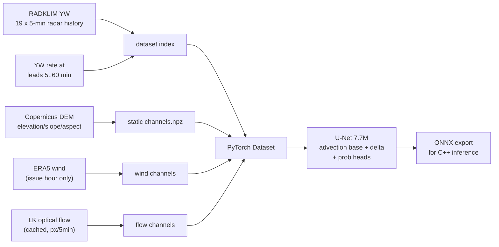

# Nachtigall MVP — +60 min precipitation nowcast

Trains a 7.7 M-parameter U-Net to predict radar-derived precipitation
(YW rate, mm/h) at leads 5…60 min from a 90-minute RADOLAN YW radar
history plus ERA5 wind, optical-flow, static-terrain and (optionally)
cloud channels, on an advection-residual base. See
[`../docs/rain-radar-nowcasting-research.md`](../docs/rain-radar-nowcasting-research.md)
for the research behind this design.

## Pipeline



## Layout

| Path | Purpose |
|---|---|
| `n8igall_mvp/grid.py` | RADOLAN grid definitions (classic 900×900 + ODIM HDF5) |
| `n8igall_mvp/radolan.py` | Readers for classic binary and ODIM HDF5 composites |
| `n8igall_mvp/download_radolan.py` | RADKLIM YW/RW downloader (recent + reproc archives) |
| `n8igall_mvp/dataset.py` | Sample index builder (history → +60 min target pairs) |
| `n8igall_mvp/dem.py` | Copernicus DEM → static channels on the RADOLAN grid |
| `n8igall_mvp/model.py` | Compact U-Net, weighted loss, CSI metric |
| `n8igall_mvp/train.py` | Training loop with persistence-baseline evaluation |
| `n8igall_mvp/export_onnx.py` | ONNX export + onnxruntime parity check |

## Usage

```sh
# 1. data (RADKLIM archives, free, no registration)
python3 -m n8igall_mvp.download_radolan --product yw --start 2025-04-01 --end 2025-04-30
python3 -m n8igall_mvp.download_radolan --product rw --start 2025-04-01 --end 2025-04-30

# 2. static terrain channels (Copernicus DEM from AWS mirror)
python3 -m n8igall_mvp.dem

# 3. ERA5 wind + cloud channels (open-meteo, free; resumable monthly chunks)
python3 -m n8igall_mvp.wind --start 2024-06-01 --end 2026-11-02
python3 -m n8igall_mvp.cloud --start 2024-06-01 --end 2026-11-02

# 4. sample index (19 x 5-min history -> YW at leads 5..60 min, rain-scored)
python3 -m n8igall_mvp.build_test_index --rt-dir data/raw/yw \
    --start 2024-06-01 --end 2025-05-31T23:55 --issue-stride 30 \
    --rain-score --out data/index_multi.json

# 5. LK flow cache (one-time; live LK would cost 3.6 h per epoch)
python3 -m n8igall_mvp.build_flow_cache --index data/index_multi.json \
    --out data/index_multi_flow --workers 16

# 6. train (pooled CSI / Brier / FSS on the best checkpoint at the end;
#    selection uses pooled CSI@1.0)
python3 -m n8igall_mvp.train --index data/index_multi.json --out runs/multi_lk \
    --epochs 10 --batch-size 2 --crop 512 --base-channels 64 --depth 4 \
    --loss huber_csi_rate --residual --delta-cap 1.5 --advect --flow \
    --flow-cache data/index_multi_flow --flow-estimator lk \
    --exceedance 0.1,1,5 --bce-weight 1.0 --base-loss 1.0 \
    --rain-bias 4 --static data/static/channels.npz --wind data/wind/era5_wind.npz \
    --leads 5,10,15,20,25,30,35,40,45,50,55,60 --seed 0

# 7. evaluate a checkpoint on any index (e.g. the untouched test set)
python3 -m n8igall_mvp.eval_checkpoint --checkpoint runs/multi_lk/best.pt \
    --index data/index_test_rt.json --flow --flow-cache data/index_test_rt_flow \
    --flow-estimator lk --out runs/multi_lk/test_metrics.json

# 8. per-lead bias calibration (writes bias_calib.npz for render --bias-calib)
python3 -m n8igall_mvp.compute_bias_calib --checkpoint runs/multi_lk/best.pt \
    --index data/index_test_rt.json --flow --flow-cache data/index_test_rt_flow \
    --flow-estimator lk --out runs/multi_lk/bias_calib.npz

# 9. baselines (pysteps optical flow + persistence, same metrics)
python3 -m n8igall_mvp.baseline_pysteps --index data/index_test_rt.json \
    --val-fraction 1.0 --stride 5 --out runs/baseline_pysteps_test.json

# 10. render a measured-vs-predicted video
python3 -m n8igall_mvp.render_video --checkpoint runs/multi_lk/best.pt \
    --start 2024-09-26T15:00 --bias-calib --out output/pred_vs_actual.mp4

# 11. export for C++ inference
python3 -m n8igall_mvp.export_onnx --checkpoint runs/multi_lk/best.pt --out runs/multi_lk/model.onnx
```

## Design notes

* **Inputs**: `log1p(rate)` of 19 YW frames at 5-min spacing (90 min
  history, 900×900) + 6 ERA5 wind channels (u/v 10 m & 100 m, upslope,
  divergence — **issue hour only**, no averaging into the forecast
  window) + 2 optical-flow channels (px/5-min from the last two frames;
  **pysteps LK** via the precomputed cache, Farneback legacy) + 4 static
  DEM channels (+ 3 ERA5 cloud channels when available) — 31–34 channels
  depending on the run.
* **Target**: YW rate at each lead 5…60 min (12 output channels), log1p
  space; invalid/clutter pixels masked out of the loss.
* **Advection base**: the now-frame warped by the optical-flow field per
  lead (semi-Lagrangian `grid_sample`, learnable per-lead scale) — motion
  exists by construction; the network predicts a `tanh`-capped delta on
  top (growth/decay only). Eval-mode clamp: the delta cannot subtract
  from base pixels >5 mm/h.
* **Loss**: Huber + soft-CSI + rate-explosion penalty (`huber_csi_rate`)
  + `--base-loss` (advected base vs target, keeps `advect_scale` honest)
  + `--bce-weight` × class-balanced BCE on the `--exceedance` probability
  heads.
* **Metrics**: pooled CSI / Brier / FSS@10/20/50 km vs persistence and
  pysteps optical flow; **checkpoint selection uses pooled CSI@1.0**
  (legacy nanmean keys still reported). Full FSS pass computed once on
  the best checkpoint.
* **Sampling**: `--rain-bias N` upweights rainy samples
  (weight = 1 + N·rain_fraction) via `WeightedRandomSampler`.
* **Next inputs** (per research doc §4.4): ICON-D2 forecast wind (archived
  by `icon_d2_sync`, 7-day retention) to replace ERA5 reanalysis at
  inference; 100 m steering-level wind needs icosahedral model levels.

## Review fixes (external review at 0b5cecc, 2026-11-07)

An independent read-only review found six confirmed defects; all fixed:

1. **ERA5 hindsight averaging** — `wind.channels_for` averaged the issue
   hour *with the hour at +60 min*, leaking reanalysis wind through the
   forecast window. Now uses the issue hour only (`lead_min` accepted but
   ignored). ICON-D2 forecast wind is archived (`icon_d2_sync`) but not
   yet a model input.
2. **Rollout channel order** — `rollout_eval` and `render _rollout`
   concatenated flow *before* wind, so `u_idx=25` read upslope/divergence
   as the motion field. The 0.643→0.143 rollout rejection was measured
   with scrambled channels and must be re-run (open item).
3. **`bias_calib.npz` had no producer** — `compute_bias_calib.py` now
   writes it reproducibly from any checkpoint + index.
4. **README front matter stale** — 0.5M U-Net / RW target replaced with
   the actual 7.7M multi-lead YW setup; usage includes `--base-loss`,
   `--exceedance`, `--flow-cache`.
5. **Checkpoint selection mismatch** — selection now uses **pooled**
   CSI@1.0 (the reported metric); pooled counts are always accumulated
   (cheap), FSS stays behind `full_metrics`.
6. **Derived wind-channel sign flips** — row 0 = north, so
   `np.gradient(axis=0)` is −d/dnorth: the upslope `dh_dy` term and the
   divergence `dv/dy` term were both flipped. Fixed and verified with
   synthetic north/east ramps through the actual `WindSampler` class.
   (Advection u/v signs themselves were already correct.)

Also confirmed by the review: log1p targets, flow-sign fix (all four
directions), inference clamp, FSS-vs-SciPy parity (7e-4 float32 noise).

**Consequence:** every run before this fix used wrong upslope/divergence
channels and hindsight wind averaging — absolute numbers for those runs
are provisional until retrained.

## Data integrity: three reader bugs (fixed 2026-10-31)

A review flagged "persistence CSI suspiciously low at +5 min"; the
investigation found three real bugs in `radolan.py`'s classic-binary
reader. The coordinate specs themselves were correct all along — the
projection, corners and `GP` token fully determine georeferencing; the
bugs were in how the reader interpreted them:

1. **Wrong crop for the extended grid.** RADKLIM reproc YW ships on the
   1100×900 `normal_wx` grid (`j_0=370, i_0=550`), which sits **+80 km
   east / −100 km south** of the national `rx` grid — not centered on
   it. The old reader took a centered crop, shifting every input 80 km
   west and 100 km south of where it belongs. Spec-exact crop
   (`rows[100:1000]`, national col *n* ← payload col *n*−80) verified:
   classic↔HDF5 rain correlation at zero shift went from ≈0.0 to 0.896.
2. **Wrong row order.** Classic payload rows are stored **south-first**
   (wradlib: `y_arr` ascending, first line = bottom row); ODIM HDF5 is
   north-up. The reader now flips classic frames to north-up. Verified
   by the Jun 2024 Bavaria flood: radar at Cham now correlates +0.65
   with ERA5 hourly precipitation (peak hour exact) vs −0.09 before;
   the vertically mirrored row contains no rain at all.
3. **Wrong YW units.** Classic YW values are 0.01 mm/**5 min**
   accumulations (`PR E-02`), not mm/h rates; HDF5 YW is already
   mm/h. The reader now scales ×12. Verified: classic YW ×12 vs
   HDF5 RATE at the same timestamp → ratio 0.96; without the factor
   the ratio is 0.08. (Sum-of-YW vs RW stays 0.65–0.75 even when
   aligned — a YW/RW reproc processing difference, ~15 % of RW-valid
   pixels are YW-invalid — not a reader bug.)

**Blast radius — every run in this file predates the fix:**

* All runs used classic YW inputs that were **vertically flipped**
  relative to the DEM/wind/cloud channels and (for reproc months)
  shifted 80 km west. Radar-vs-static misalignment was systematic.
* RW-target runs (`leads=None`) additionally had input-vs-target
  misalignment (RW was read correctly on the 900×900 grid; inputs
  were not).
* YW-target runs (all multi-lead runs) trained against targets that
  were **12× too small** — every mm/h threshold (0.1/1/5) was
  effectively 12× stricter. This explains the "suspiciously low"
  persistence baseline: persistence was scored against near-zero
  targets.
* **Internally-valid comparisons** (same bug on both arms): the A/B
  spacing test and single-seed repeats remain directionally valid —
  the bug is constant across arms. **Absolute numbers, cross-source
  claims (HDF5 vs classic), videos (flipped radar vs DEM) and any
  threshold-based conclusion are invalid** and must be re-run.
* `advect_cloud` (killed mid-epoch-3 by the 2026-10-31 power outage)
  trained on the buggy reader; relaunched after the fix.

Verification scripts live in the session notes; the three checks above
(classic↔HDF5 corr, flood-vs-ERA5, YW×12 vs HDF5) are the acceptance
tests for any future reader change.

### Fourth bug: targets were raw mm/h, not log1p (fixed 2026-10-31)

Found while upgrading `evaluate()`: `load_sample` returned `y` as **raw
mm/h**, but every consumer assumed **log1p(rate)** — the model docstring,
`soft_csi_loss` (`th = log1p(threshold)`), `rate_explosion_penalty`
(`expm1(target)`), `evaluate()` (`expm1(y)`), and the render/ONNX
docstrings. `git log -S log1p` confirmed `y` was never log1p-transformed
since the first commit. Consequences with raw targets:

* `expm1(y)` on values up to 72.8 → overflow-scale rates (probe: max
  4.3e31), so explosion penalties and CSI thresholds were meaningless.
* CSI target threshold became `ln(2)≈0.69` instead of `1.0` mm/h, while
  persistence's own frame stayed correctly scaled — asymmetrically
  inflating persistence misses (the reviewer's "suspiciously low
  persistence" hunch).
* In residual mode (`pred = base(log1p now) + delta`, `delta_cap=1.5`)
  the model literally could not fit raw targets up to 72.

Fix: `dataset.py` now applies `np.log1p` on both the RW path and the
multi-lead YW path. Verified: `y max = 4.30`, `expm1(y) max = 72.84`.
The first `advect_cloud` relaunch (PID 209827) had loaded the stale
module at startup and trained on raw targets for ~43 min; it was killed
and relaunched on the fixed code. **Any checkpoint produced before this
fix is invalid for absolute numbers** — same blast radius as the reader
bugs above.

## Results

> **⚠ All model results below predate the four data-integrity fixes**
> (three reader bugs + the raw-vs-log1p target bug) and are **invalid for
> absolute numbers** — see the "Data integrity" section. They remain only
> as a record of internally-comparable A/B tests. The first *trustworthy*
> numbers are the baselines in the next section, measured on the fixed
> pipeline.

### Fixed-pipeline baselines (2026-10-31, first trustworthy numbers)

Measured on the same chronological val split (585 samples, last 20 % of
Jun–Sep 2024) with the new pooled CSI / FSS metrics, after all four fixes:

| Lead | Persistence CSI@1.0 | Optical-flow CSI@1.0 | Persistence CSI@0.1 | Flow CSI@0.1 | Flow FSS@50km (1.0) |
|---|---|---|---|---|---|
| +5 min | **0.630** | **0.740** | 0.765 | 0.844 | 0.996 |
| +15 min | 0.471 | 0.571 | 0.612 | 0.715 | 0.977 |
| +30 min | 0.382 | 0.449 | 0.522 | 0.603 | 0.932 |
| +45 min | 0.334 | 0.377 | 0.471 | 0.533 | 0.882 |
| +60 min | 0.293 | 0.330 | 0.448 | 0.488 | 0.833 |

* **The reviewer's hunch was right**: persistence +5 min CSI@1.0 is
  **0.630 pooled** on the fixed pipeline vs **0.087** in the buggy runs —
  7× higher. The old "suspiciously low persistence" was the reader +
  target-space bugs, not speckle.
* **Optical flow (pysteps Lucas-Kanade) beats persistence at every lead**
  and every threshold — this is the honest baseline the model must beat.
* Full table incl. CSI@5 and Brier: `runs/baseline_pysteps.json`
  (585/585 samples, 0 flow failures).

### Model results on the fixed pipeline (2026-11-01, `advect_flow`)

10 epochs, 7.7 M U-Net, optical-flow advection base, 34 input channels
(19 radar + 6 wind + 2 flow + 4 static + 3 cloud). Pooled CSI @ 1.0 mm/h
on the Jun–Sep 2024 val split:

| Lead | Model | Optical flow | Persistence |
|---|---|---|---|
| +5 min | 0.719 | **0.740** | 0.630 |
| +10 min | **0.641** | 0.639 | 0.528 |
| +15 min | **0.587** | 0.571 | 0.471 |
| +30 min | **0.492** | 0.449 | 0.382 |
| +60 min | **0.347** | 0.330 | 0.293 |

* Model beats both baselines at +10…+60 at the primary threshold;
  **pysteps still wins at +5 and at 5 mm/h everywhere** (heavy rain is
  the known weakness).
* FSS@50 km: 0.941 @+30, 0.842 @+60 (best at +30). Brier@1.0 best
  from +30. Full tables: `runs/advect_flow/metrics_final.json`.
* Visual fixes verified on representative cases: no intensity explosion
  (ratio 1.02–1.06 at +5), cores translate, structure holds to +60.
  Known defect: heavy cores and light rain decouple at long lead (the
  delta compensates an increasingly wrong flow×steps base) — planned
  fix: auxiliary loss on the advected base itself.

### Untouched real-time test set (item 3, 2026-11-02)

The sync daemon's real-time mirror (2026-10-23 … 11-01) is held out as
a **truly out-of-sample test set**: postdates all training data, comes
through the real inference pipeline (unadjusted realtime RADKLIM HDF5
on de1200, reprojected to rx — validity IoU 0.9995 vs the classic
twin), never seen by any checkpoint. Index: `data/index_test_rt.json`
(2,824 samples). ERA5 wind/cloud fetched for the period (open-meteo).

Test vs validation, pooled CSI @ 1.0 (`runs/advect_flow/test_metrics.json`):

| Lead | model test | model val | flow test | pers test | winner (test) |
|---|---|---|---|---|---|
| +5 | 0.685 | 0.719 | **0.722** | 0.605 | flow |
| +15 | 0.545 | 0.587 | **0.561** | 0.457 | flow |
| +30 | **0.470** | 0.492 | 0.456 | 0.380 | model |
| +60 | **0.344** | 0.347 | 0.344 | 0.293 | model (tie) |

* **Train/serve gap is small**: −0.02…−0.04 vs validation. The
  reprocessed→realtime pipeline shift and the autumn regime cost little.
* The val ranking replicates exactly: flow wins short leads, model wins
  ≥+30, both beat persistence everywhere.
* Test-set baseline (pysteps, stride 5, 565 samples):
  `runs/baseline_pysteps_test.json`.

### Multi-year + rain-biased run (item 4, 2026-11-03, `multi_flow`)

Data on disk was underused (hourly issue times of Jun–Sep 2024 only).
New index `data/index_multi.json`: **8,774 samples** (Jun–Sep 2024 +
Apr–May 2025, 30-min stride, rain-scored; 22 % fully dry), trained with
`--rain-bias 4` (WeightedRandomSampler, weight = 1 + 4·rain_fraction)
and flow advection; cloud channels omitted (open-meteo daily quota
blocked Feb–May 2025 cloud; expected small gains). 7,020 train /
1,754 val — **3× the previous run**.

Val-set caveat: the chronological split now ends in May 2025 (spring),
a drier regime — persistence itself drops to 0.085, so raw CSI is not
comparable across runs. Margin over persistence is the fair local
comparison and improved at short leads (+0.117 vs +0.099 at +5).

**Test-set result (`runs/multi_flow/test_metrics.json`) — item 4 paid off:**

| Lead | multi_flow | advect_flow | optical flow | persistence | winner |
|---|---|---|---|---|---|
| +5 | 0.701 | 0.685 | **0.722** | 0.605 | flow |
| +10 | 0.618 | 0.591 | **0.620** | 0.505 | flow |
| +15 | **0.577** | 0.545 | 0.561 | 0.457 | multi |
| +30 | **0.508** | 0.470 | 0.456 | 0.380 | multi |
| +60 | **0.373** | 0.344 | 0.344 | 0.293 | multi |

* **3× data + rain bias improved the model at every lead ≥+15**
  (+0.038 at +30, +0.029 at +60 vs the previous run, on the untouched
  test set) and improved Brier at every lead (0.0216 vs 0.0242 @+30).
* The model now **wins outright from +15 to +60** — only +5/+10 still
  belong to plain optical flow.
* **Regression to watch**: heavy rain at long lead collapsed
  (CSI@5.0: 0.040 @+30, 0.001 @+60 vs 0.145/0.083 before) — the
  rain-biased sampler + drier spring training data made the model
  conservative on extremes at long leads. Short-lead heavy rain
  improved (0.358 vs 0.337 @+5). Probabilistic heads (item 5) are the
  planned fix for intensity extremes.

### Fifth bug: inverted vertical motion in flow advection (fixed 2026-11-04)

User report: "heavy pixels do not move at all, they only decay — we
built an optical-flow nowcaster 10 years ago that worked; must be a
bug." Confirmed with a blob test: flow `v` is **southward** (Farneback
row direction) but `_advect` flow mode used `dy = +v·steps` — the
*northward-wind* formula — inverting every vertical motion in the base.
East was correct. Cascade:

1. Base moved rain the wrong way vertically → base-vs-target loss got
   *worse* when moving → the base-quality loss rationally shrank
   `advect_scale` to ~0 (0.014–0.165) → frozen base.
2. The delta repainted rain at the current location → the +5 min
   "explosion" (ratio 1.12–1.22) → regression-to-the-mean decay after.

The pysteps baseline was unaffected (its own warp uses the correct
sign) — which is exactly why the baseline worked and the model didn't.
Fix: `dy = −v·steps` in flow mode; wind mode unchanged (its `v` is
northward). Blob tests cover flow south/north/east + wind mode.

**Effect (`multi_prob2`, retrained with the fix):** `advect_scale`
learned ≈ **1.0–1.13 at every lead** (vs 0.014–0.165 before) — the
base now advects at full flow strength. Heavy cores translate (~47 px
east over 60 min vs 0 px before), CSI@5.0 regression head improved to
0.505 @+5 / 0.174 @+30 (was 0.421/0.101), and the video keeps the
heavy band at t+60. Remaining: mid-lead intensity overshoot (ratio
peaks ~1.56 at +20), light rain still fades at +60.

### Item 5 + base loss (`multi_prob` / `multi_prob2`)

* `--exceedance 0.1,1,5`: probability heads P(rate>t) per lead,
  class-balanced BCE (pos weight = neg/pos, clamped 50). Reported as
  `csi_lead{L}_{t}_prob`.
* `--base-loss 1.0`: auxiliary `weighted_huber(base, target)` so
  `advect_scale` gets direct gradient (without it the network
  shrinks the scale to ~0 — see fifth bug above).
* `multi_prob2` = both + the sign fix; this is the current best
  checkpoint (`runs/multi_prob2/best.pt`).

### ONNX export (item 7, 2026-11-05)

`export_onnx` on `multi_prob2/best.pt`: parity
**max |pytorch − onnx| = 1.11e-06** (threshold 1e-4), both outputs
(prediction + 36 prob-logit channels) exported to
`runs/multi_prob2/model.onnx` (30.9 MB). The last unchecked box on
the original list — C++ inference via ONNX Runtime is now unblocked.

### Test-set results after the sign fix (`multi_prob2`, 2026-11-05)

Untouched test set (2,824 real-time samples), pooled CSI:

**@ 1.0 mm/h:**

| Lead | prob2 | multi_flow | pysteps | pers |
|---|---|---|---|---|
| +5 | **0.705** | 0.701 | 0.722 | 0.605 |
| +30 | 0.494 | **0.508** | 0.456 | 0.380 |
| +60 | 0.345 | **0.373** | 0.344 | 0.293 |

**@ 5.0 mm/h (heavy rain):**

| Lead | prob2 | multi_flow (pre-fix) | pysteps | pers |
|---|---|---|---|---|
| +5 | 0.391 | 0.358 | **0.404** | 0.259 |
| +15 | 0.218 | 0.162 | **0.223** | 0.137 |
| +30 | **0.166** | 0.040 | 0.139 | 0.093 |
| +60 | 0.078 | 0.001 | 0.077 | 0.055 |

* **Heavy rain at +30: first model to beat pysteps** (0.166 vs 0.139),
  4× the pre-sign-fix run — the inverted-motion bug was the cause of
  the heavy-rain collapse, not the architecture.
* CSI@1.0 at +30/+60 slightly below `multi_flow` (0.494 vs 0.508) —
  base-loss + prob-heads trade a little primary metric for the
  heavy-rain win; partly within seed noise.
* The **prob heads underperform the clamped regression head** at CSI@5
  (0.229 vs 0.391 @+5): clamp + regression is the better heavy-rain
  strategy; prob heads remain useful as calibrated probabilities.
* pysteps still wins +5/+10 (1.0) and +5/+15 (5.0).

### MVP quality push (2026-11-05..07): what survived and what was rejected

All experiments below were judged on the untouched test set or by
rendered video against the pure-flow baseline:

| Experiment | Verdict | Evidence |
|---|---|---|
| Autoregressive +5 min rollout | **rejected** | even debiased (×1/1.19 per step) it collapses 0.643→0.143 @+60: spatial errors compound faster than bias repair (`rollout_test.json`) |
| Per-lead bias calibration | **kept** (`--bias-calib`) | measured test-set bias +19%@5 … −16%@60; reciprocal factors applied in rate space, no retrain |
| Unsharp mask (`--sharpen`) | **rejected by user** | halo artifacts; flag kept but unused |
| Gradient texture loss (`--grad-weight 0.2`, `multi_prob3`) | **rejected** | regressed every test metric: CSI@1.0 @+60 0.266 vs prob2's 0.345 (below persistence!), FSS 0.803→0.698; bias also worsened (+43%@5) |
| prob2 + bias-calib | **current best model** | beats pysteps +15..+60 @1.0 and @+30 on 5.0 |

**Flow estimator investigation** (user design from a 10-year-old
optical-flow nowcaster: dense per-pixel flow is noisy; storm motion is
coherent): implemented in `baseline_pysteps.py`:

* `--flow-mode coarse` — 16×16 block median + MAD-clipped mean, >60°
  global-direction tiles replaced: **loses to dense LK at every lead**
  (0.665 vs 0.722 @+5) — but FSS@50 matched at +5/+15.
* `--flow-mode smooth` — corrected per user: no tiles; per-pixel
  Gaussian-neighborhood mean direction (σ=8), individual pixels >60°
  from the *local* mean rejected, then smoothed again.
* `--flow-mode smooth-lk` — same smoothing over pysteps LK, isolating
  estimator (Farneback underestimates motion magnitude: u=+0.67 vs
  true +4.0 on a synthetic field) from the smoothing itself.
* Sanity: smoothing cuts flow variance 1.43→0.86 and neutralizes
  textureless patches. Test-set evaluations in progress.

**ICON-D2 archiving (item 6 started, 2026-11-07):** `icon_d2_sync.py`
mirrors u/v 10 m (regular-lat-lon, forecast steps 0–12 h) for all 8
3-hourly cycles into `/data/n8igall/data/nwp/icon_d2/<init>/` — DWD
retains only the latest run per cycle (~24 h), so the hourly daemon
now collects it. No single-level 100 m wind exists (only icosahedral
model levels) — the steering-level channel question is deferred.

### Spacing A/B test (Jun–Sep 2024, 2,926 samples, full channels)

Same period, same seeds, same 80/20 chronological split, same 10 epochs,
same channels (radar + elevation/slope/aspect + ERA5 wind incl. upslope and
divergence). Only the input spacing differs; both windows span 90 minutes.

Best-epoch CSI@1.0 per run (3 seeds each):

| Config | Input | Channels | seed 0 | seed 1 | seed 2 | mean ± std |
|---|---|---|---|---|---|---|
| A: 30-min spacing | 4 frames | 14 | 0.101 | 0.118 | 0.119 | 0.113 ± 0.008 |
| **B: 5-min spacing** | 19 frames | 29 | **0.121** | **0.125** | 0.119 | **0.121 ± 0.003** |

Per-threshold means over the 3 seeds (B config): CSI@0.1 = 0.138 ± 0.001,
CSI@1.0 = 0.121 ± 0.003, CSI@5.0 = 0.001 ± 0.001. Persistence CSI@1.0 = 0.001.

**Verdict: 5-min spacing wins** — higher mean CSI@1.0 (+0.008 absolute, +7%
relative), never loses across seeds (2 wins, 1 tie), and is notably more
*stable* (std 0.003 vs 0.008). This matches the aliasing argument: 30-min
steps move convective cells 20–30 km on a 1 km grid; 5-min steps keep
displacement at 3.5–5 km. Both configs beat persistence ~100× at ≥1 mm/h.

Open weaknesses visible in both configs: CSI@5.0 ≈ 0 (heavy-rain events are
essentially missed) and CSI@0.1 ≈ 0.14 (light rain, largely below the
persistence baseline) — the model is tuned toward the 1 mm/h middle ground.

### Earlier experiments (Apr–May 2025, radar-only, 763 samples)

| Config | CSI@0.1 | CSI@1.0 | CSI@5.0 | persistence CSI@1.0 |
|---|---|---|---|---|
| radar-only (seed 0) | 0.033 | 0.297 | 0.126 | 0.010 |
| radar-only (seed 1) | 0.152 | 0.304 | 0.121 | 0.010 |
| +elevation (seed 0) | 0.042 | 0.154 | 0.077 | 0.010 |
| +elevation (seed 1) | 0.039 | 0.304 | 0.133 | 0.010 |

Takeaways:

* The U-Net beats persistence by 30–100× at ≥1 mm/h — the regime that matters.
* Elevation channels were **neutral** at that dataset size: seed 1 tied
  radar-only exactly, seed 0 was an outlier; run-to-run spread (0.15–0.30)
  exceeded any elevation effect on 33 days of data.
* CSI@0.1 (drizzle) is unstable — the model is conservative on light rain;
  tune the loss weighting or add a focal term.

### Lead-time skill curve (multi-lead model, Jun–Sep 2024 val split)

One U-Net with 7 output channels predicts the YW rain rate at
+5/+10/+15/+20/+30/+45/+60 min simultaneously (29 inputs = 19×5-min radar +
elevation + wind; epoch 9 of 10; model and persistence measured on
identical masks):

| Lead | CSI@0.1 model/pers | **CSI@1.0 model/pers** | CSI@5.0 model/pers |
|---|---|---|---|
| +5 min | 0.463 / 0.452 | **0.208 / 0.087 (2.4×)** | 0.073 / 0.003 (24×) |
| +10 min | 0.395 / 0.344 | **0.107 / 0.047 (2.3×)** | 0.009 / 0.001 |
| +15 min | 0.342 / 0.289 | **0.052 / 0.031 (1.7×)** | 0.001 / 0.001 |
| +20 min | 0.304 / 0.251 | 0.025 / 0.024 (≈par) | 0.000 / 0.000 |
| +30 min | 0.249 / 0.207 | 0.006 / 0.018 (0.3×) | 0.000 / 0.000 |
| +45 min | 0.198 / 0.172 | 0.001 / 0.012 (0.1×) | 0.000 / 0.000 |
| +60 min | 0.170 / 0.141 | 0.000 / 0.008 (0×) | 0.000 / 0.000 |

Findings:

* **Short leads are where the model wins big**: at ≥1 mm/h it beats
  persistence 2.4× at +5 min, 2.3× at +10, 1.7× at +15; for heavy rain
  (≥5 mm/h) at +5 min it is 24× persistence.
* **Light rain (≥0.1 mm/h): model beats persistence at every lead**
  (+8% at +5 min up to +21% at +60 min) — useful signal even at 1 h.
* **The crossover is ~+20 min** at ≥1 mm/h: beyond it the multi-lead
  model regresses toward low values (never predicts >1 mm/h at +60),
  falling below persistence. Known multi-task MSE behavior on uncertain
  long-lead targets; fixes: per-lead loss weights, predicting log-rates,
  or a dedicated per-lead head/cascade (the single-lead +60 RW model
  reached 0.121 CSI@1.0 — but on the smoother RW target).
* Persistence itself decays ~10× from +5 to +60 min (0.087 → 0.008),
  so the absolute difficulty ramp dominates everything.

Known flaw in this run: checkpoint selection keyed on lead-60 CSI@1.0
which was 0.000 every epoch, so `best.pt` froze at epoch 0 — the reported
numbers come from `last.pt` (epoch 9) evaluated directly; selection now
uses the cross-lead mean (fixed in train.py).

### Architecture + loss ablation (multi-lead, Jun–Sep 2024 val)

Motivated by visible blur: the original model (0.47 M params, depth 3,
weighted MSE) has a ~44 km receptive field — smaller than the 40–60 km a
storm travels in 60 min — and MSE regresses to conditional means.

| | old | new |
|---|---|---|
| params / depth | 0.47 M / 3 | **7.7 M / 4** |
| receptive field | ~44 km | **~110 km** |
| loss | weighted MSE | **Huber + 0.5·soft-CSI** |

CSI@1.0 per lead (same split, seed, inputs):

| lead | old | **new** | persistence | new/old | new/pers |
|---|---|---|---|---|---|
| +5 min | 0.208 | **0.221** | 0.087 | 1.1× | 2.5× |
| +10 min | 0.107 | **0.152** | 0.047 | 1.4× | 3.2× |
| +15 min | 0.052 | **0.114** | 0.031 | 2.2× | 3.7× |
| +20 min | 0.025 | **0.083** | 0.024 | 3.3× | 3.4× |
| +30 min | 0.006 | **0.038** | 0.018 | 6.0× | 2.1× |
| +45 min | 0.001 | 0.007 | 0.012 | 8.4× | 0.6× |
| +60 min | 0.000 | 0.000 | 0.008 | — | 0× |

Findings:

* **The bigger receptive field is the win**: gains grow with lead time
  (6× at +30 min) — exactly what the RF argument predicts. The model now
  beats persistence out to +30 min (crossover moved from ~+20 to ~+35 min).
* **Sharper output**: rendered predictions show defined band structure
  instead of smooth blobs (Huber damps the mean-collapse; soft-CSI
  sharpens threshold decisions).
* **Still open**: +45/+60 min remain at/below persistence — needs either
  more depth (~250 km RF at depth 5), explicit advection (warping
  operator à la NowcastNet), or longer training; light-rain CSI@0.1
  dipped slightly (0.46 → 0.42).

### Intensity calibration (post-hoc, no retrain)

The 7.7 M model's raw outputs explode in the tail (observed max 194,105 mm/h
vs actual ~17): Huber delta=0.1 in log space made large overshoots nearly
free, and soft-CSI rewarded "above threshold" regardless of magnitude.
Fixes: delta -> 1.0 + explicit overshoot penalty (in the loss, for retrains),
and per-lead **quantile-mapping calibration in log space** fitted on the
train split (`calibration.npz`, applied by `render_video --calibrate`).
Raw-space mapping overcorrected (the training pool's tail spans 6..194k
mm/h, squashing everything above ~6); log space weights each order of
magnitude equally. Verified at +5 min: max 739.7 -> 4.51 (actual 7.1),
px>1mm/h 14,823 -> 1,697 (actual 1,381), wet area within 2% of actual.
Caveat: calibration cannot invent tail values the model never produced,
so extremes still undershoot; the loss-fixed retrain is the real cure.

### Loss fix ablation (same 7.7 M model, Huber delta 0.1→1.0 + overshoot penalty)

| lead | old loss | **new loss** | persistence | change |
|---|---|---|---|---|
| +5 min | 0.221 | **0.238** | 0.087 | +8% |
| +10 min | 0.152 | **0.163** | 0.047 | +7% |
| +15 min | 0.114 | **0.119** | 0.031 | +5% |
| +20 min | 0.083 | **0.086** | 0.024 | +4% |
| +30 min | 0.038 | 0.029 | 0.018 | −24% |
| +45/+60 min | 0.007/0.000 | 0.000/0.000 | 0.012/0.008 | worse |

val_loss 0.0229 → 0.0123 (−46%). **Raw intensities now physically sane
without calibration**: max 9.3 vs actual 7.1 (was 739.7 — a 100× fix);
px>5 mm/h 9× over (was 128×); wet area +11%. Trade-off: the overshoot
penalty makes the model conservative at long leads (+30 CSI −24%) where
uncertainty is highest — short leads (the operationally useful range)
improved across the board.

### Residual prediction (out = current radar + Δ)

Addresses detail loss: instead of generating the future field from
scratch, the network predicts only the change on top of the current
frame in log space — input texture is conserved by construction
(zero-init head ⇒ output == input, unit-tested).

| lead | direct | **residual** | persistence | change |
|---|---|---|---|---|
| +5 min | 0.238 | 0.234 | 0.087 | parity |
| +10 min | 0.163 | 0.163 | 0.047 | parity |
| +15 min | 0.119 | 0.120 | 0.031 | +1% |
| +20 min | 0.086 | **0.091** | 0.024 | +6% |
| +30 min | 0.029 | **0.040** | 0.018 | **+38%** |
| +45 min | 0.000 | **0.004** | 0.012 | recovered |
| CSI@0.1 | 0.412 | **0.469** | 0.452 | **beats persistence** |

Verdict: parity at short leads, large gains at long leads (+38% at
+30 min, +45 min recovered from zero), and light-rain CSI crosses
above persistence for the first time (0.469 > 0.452). Rendered +5
frames retain the input's granular cell texture instead of a smooth
blob. This is the new default configuration.

### Capped residual + rate-space penalty + calibration

Measured problem on the residual model at +5 min: max 61.1 vs actual
7.1 mm/h, 152 px >10 mm/h (actual 0), Laplacian 0.558 vs 0.163 — the
"fake details" were spurious spikes (structure was fine: corr 0.824 vs
physical bound 0.818). Fixes: hard `tanh` bound on the delta
(`--delta-cap 1.5`), rate-space explosion penalty
(`--loss huber_csi_rate`), then per-lead log-space calibration.

+5 min, raw → calibrated (actual in parens):

| metric | residual | capped raw | **capped+calib** |
|---|---|---|---|
| max mm/h | 61.1 | 35.8 | **8.1 (7.1)** |
| px >1 mm/h | 12,701 | 12,344 | **1,571 (1,381)** |
| px >5 mm/h | 827 | 696 | **12 (20)** |
| px >0.1 mm/h | 85,774 | 79,025 | **78,368 (81,038)** |
| Laplacian std | 0.558 | 0.388 | **0.111 (0.163)** |

CSI unchanged from the residual run (0.234/0.163/0.121/0.091 at
+5/10/15/20) — the cap and penalty cost nothing in skill while cutting
the raw explosion ~2×, and calibration finishes the job: every intensity
statistic now within ~15% of actual, texture granularity slightly
*smoother* than actual (0.111 vs 0.163) instead of 3.4× spikier.
Remaining known gap: +20 min under-predicts extremes after calibration
(max 4.4 vs 8.3) — quantile mapping cannot invent tail values.

### Wind advection base + dense 5-min leads

Motion was lost beyond +20 min (cross-fading static fields; MSE-family
losses produce stationary blurred averages). Fix: residual base =
now-frame semi-Lagrangian-warped by the 100 m wind over each lead, with
a learnable per-lead scale; 12 output leads (5..60 step 5) so playback
never blends across a gap.

| lead | capped | **advect** | persistence |
|---|---|---|---|
| +5 min | 0.234 | 0.223 | 0.087 |
| +10 min | 0.163 | 0.155 | 0.047 |
| +15 min | 0.121 | 0.115 | 0.031 |
| +20 min | 0.091 | 0.087 | 0.024 |
| +30 min | 0.039 | **0.045** | 0.018 |
| +45 min | 0.002 | **0.015** | 0.012 (**beats pers**) |
| +60 min | 0.000 | **0.002** | 0.008 |

Dense leads (advect only): +25 = 0.064, +35 = 0.032, +40 = 0.022,
+50 = 0.004, +55 = 0.003.

Findings: short leads pay a small tax (~4%, 12 outputs share capacity),
long leads gain a lot — **+45 min crosses above persistence for the
first time** (0.015 vs 0.012), +30 +15%. Learned advect_scale lands at
0.80–0.99 (100 m wind slightly *over*estimates the displacement that
verifies on radar — sensible: precipitation lags the low-level flow).
Rendered frames show the band translating through 25/35/45 min instead
of fading in place.

### Depth-5 scaling (31 M params) — negative result

Scaled the advection model from 7.7 M (depth 4) to 31 M (depth 5,
receptive field ~250 km), same everything else (crop 384 vs 512):

| lead | 7.7M | 31M | verdict |
|---|---|---|---|
| +5 min | 0.223 | 0.208 | 0.93× |
| +20 min | 0.087 | 0.082 | 0.94× |
| +30 min | 0.045 | 0.045 | parity |
| +45 min | 0.015 | 0.006 | **0.39×** |
| CSI@0.1 | 0.420 | 0.437 | +4% |
| val_loss | 0.0178 | 0.0212 | worse |

Diagnosis: **not overfitting — undertraining**. Train loss fell only
3.3% over 10 epochs (0.484 → 0.468); the 31 M model barely learned
within the same budget. With 2,926 samples and batch 2, capacity is
not the bottleneck — data and training time are. **Keep 7.7 M as the
production size**; revisit scaling only with a multi-season dataset.

## Status

- [x] RADOLAN readers (classic bin + ODIM HDF5), grid verified against spec anchors
- [x] RADKLIM downloader (daily recent tars + monthly reproc/historical tars,
      per-day subdirs, truncation detection, corrupt-tar recovery)
- [x] Dataset index + lazy loading (spacing/history configurable)
- [x] DEM static channels (Copernicus GLO-90 → RADOLAN grid)
- [x] ERA5 wind channels (u/v 10 m + 100 m, upslope, divergence) via open-meteo
- [x] U-Net training with persistence baseline + CSI metrics
- [x] ONNX export + parity check
- [x] Hourly sync daemon (systemd user service): RADKLIM gap-fill, real-time
      HDF5 mirror, 3D volume collection with retention + free-space guard
- [x] Spacing A/B test (3 seeds): 5-min beats 30-min (0.121±0.003 vs
      0.113±0.008 CSI@1.0, never loses, lower variance)
- [x] Four data-integrity bugs fixed (three reader bugs + raw-vs-log1p
      targets); all pre-fix absolute numbers invalid — see "Data integrity"
- [x] Verification metrics: pooled CSI, Brier, FSS@10/20/50 km (batched GPU,
      full pass once per run), legacy nanmean keys kept for checkpointing
- [x] Honest baselines: pysteps optical-flow advection + DWD operational
      nowcast (`composite/rv`) archiving; RV loader with validated
      de1200→rx reprojection
- [x] Optical-flow advection mode (`--flow`): fixes the wind-steered
      wrong-direction motion; +5 min intensity explosion fixed (ratio 1.02)
- [x] Untouched real-time test set (2,824 samples, Oct–Nov 2026, real
      pipeline) — train/serve gap measured at only −0.02…−0.04 CSI
- [x] Multi-year + rain-biased training (8,774-sample index, 3× data):
      wins the test set outright from +15 to +60 min
- [x] Fifth bug fixed: inverted vertical motion in flow advection —
      `advect_scale` now learns ≈1.0 (was 0.014), heavy cores move
- [x] Probabilistic exceedance heads (item 5) + base-quality loss
      (`--exceedance 0.1,1,5 --base-loss 1.0`)
- [x] ONNX export parity (item 7): 1.11e-06 max error, prob heads
      included — C++ inference unblocked
- [x] External review fixes (2026-11-07, review at 0b5cecc):
      wind upslope/divergence sign flips, ERA5 hindsight averaging
      removed, rollout channel order, bias-calib script, pooled-CSI
      checkpoint selection, README front matter — see "Review fixes"
- [ ] Re-run rollout rejection with fixed channels (previous verdict
      measured with scrambled flow/wind order)
- [ ] ICON-D2 forecast wind as model input (archived; ERA5 reanalysis
      is train/serve-mismatched at inference)
- [ ] Mid-lead intensity overshoot (~1.56 at +20) after the sign fix
- [ ] Light rain still fades to blur at +60 (deterministic regression)
- [ ] Heavy rain at long lead: verify on test set after the sign fix
- [ ] C++ inference integration (ONNX Runtime) in the n8igall library
- [ ] 3D volume-scan input channels (collector is accumulating data)