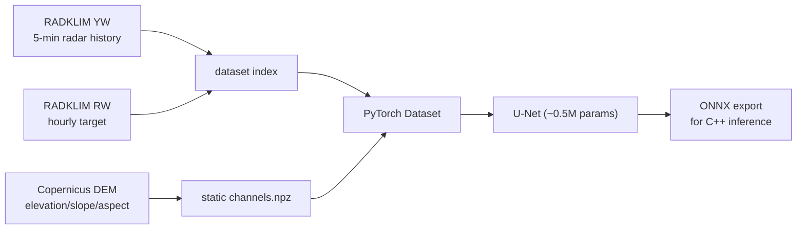

# Nachtigall MVP — +60 min precipitation nowcast

Trains a compact U-Net to predict radar-derived precipitation (RW, mm/h) 60
minutes ahead from recent RADOLAN YW radar history plus static terrain
channels. See [`../docs/rain-radar-nowcasting-research.md`](../docs/rain-radar-nowcasting-research.md)
for the research behind this design.

## Pipeline



## Layout

| Path | Purpose |
|---|---|
| `n8igall_mvp/grid.py` | RADOLAN grid definitions (classic 900×900 + ODIM HDF5) |
| `n8igall_mvp/radolan.py` | Readers for classic binary and ODIM HDF5 composites |
| `n8igall_mvp/download_radolan.py` | RADKLIM YW/RW downloader (recent + reproc archives) |
| `n8igall_mvp/dataset.py` | Sample index builder (history → +60 min target pairs) |
| `n8igall_mvp/dem.py` | Copernicus DEM → static channels on the RADOLAN grid |
| `n8igall_mvp/model.py` | Compact U-Net, weighted loss, CSI metric |
| `n8igall_mvp/train.py` | Training loop with persistence-baseline evaluation |
| `n8igall_mvp/export_onnx.py` | ONNX export + onnxruntime parity check |

## Usage

```sh
# 1. data (RADKLIM archives, free, no registration)
python3 -m n8igall_mvp.download_radolan --product yw --start 2025-04-01 --end 2025-04-30
python3 -m n8igall_mvp.download_radolan --product rw --start 2025-04-01 --end 2025-04-30

# 2. static terrain channels (Copernicus DEM from AWS mirror)
python3 -m n8igall_mvp.dem

# 3. sample index (4 x 30-min history -> RW at +60 min)
python3 -m n8igall_mvp.dataset --yw-dir data/raw/yw --rw-dir data/raw/rw \
    --start 2025-04-01T00:00 --end 2025-05-03T23:00 --out data/index.json

# 4. train (evaluates CSI vs persistence baseline each epoch)
python3 -m n8igall_mvp.train --index data/index.json --out runs/v1 \
    --epochs 15 --static data/static/channels.npz

# 5. export for C++ inference
python3 -m n8igall_mvp.export_onnx --checkpoint runs/v1/best.pt --out runs/v1/model.onnx
```

## Design notes

* **Inputs**: `log1p(rate)` of 4 YW frames at 30-min spacing (900×900) +
  4 static channels (normalized elevation, slope, sin/cos aspect).
* **Target**: RW hourly accumulation valid over `(t, t+60 min]`, converted to
  mm/h; invalid/clutter pixels masked out of the loss.
* **Loss**: MSE on `log1p` rates with 5× weight on pixels > 0.1 mm/h to
  counter the extreme class imbalance (most pixels are rain-free).
* **Metrics**: CSI at 0.1/1/5 mm/h vs. a persistence baseline (last radar
  frame as prediction).
* **Next inputs** (per research doc §4.4): ICON-D2 wind fields + derived
  orographic upslope/convergence features.

## Status

- [x] RADOLAN readers (classic bin + ODIM HDF5), grid verified against spec anchors
- [x] RADKLIM downloader (daily recent tars + monthly reproc tars)
- [x] Dataset index + lazy loading
- [x] DEM static channels (Copernicus GLO-90 → RADOLAN grid)
- [x] U-Net training with persistence baseline
- [x] ONNX export + parity check
- [ ] NWP wind input channels (ICON-D2)
- [ ] Larger training set (multi-season) + hyperparameter tuning
- [ ] C++ inference integration (ONNX Runtime) in the n8igall library