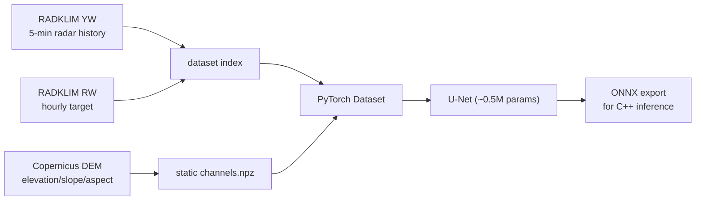

# Nachtigall MVP — +60 min precipitation nowcast

Trains a compact U-Net to predict radar-derived precipitation (RW, mm/h) 60
minutes ahead from recent RADOLAN YW radar history plus static terrain
channels. See [`../docs/rain-radar-nowcasting-research.md`](../docs/rain-radar-nowcasting-research.md)
for the research behind this design.

## Pipeline



## Layout

| Path | Purpose |
|---|---|
| `n8igall_mvp/grid.py` | RADOLAN grid definitions (classic 900×900 + ODIM HDF5) |
| `n8igall_mvp/radolan.py` | Readers for classic binary and ODIM HDF5 composites |
| `n8igall_mvp/download_radolan.py` | RADKLIM YW/RW downloader (recent + reproc archives) |
| `n8igall_mvp/dataset.py` | Sample index builder (history → +60 min target pairs) |
| `n8igall_mvp/dem.py` | Copernicus DEM → static channels on the RADOLAN grid |
| `n8igall_mvp/model.py` | Compact U-Net, weighted loss, CSI metric |
| `n8igall_mvp/train.py` | Training loop with persistence-baseline evaluation |
| `n8igall_mvp/export_onnx.py` | ONNX export + onnxruntime parity check |

## Usage

```sh
# 1. data (RADKLIM archives, free, no registration)
python3 -m n8igall_mvp.download_radolan --product yw --start 2025-04-01 --end 2025-04-30
python3 -m n8igall_mvp.download_radolan --product rw --start 2025-04-01 --end 2025-04-30

# 2. static terrain channels (Copernicus DEM from AWS mirror)
python3 -m n8igall_mvp.dem

# 3. sample index (4 x 30-min history -> RW at +60 min)
python3 -m n8igall_mvp.dataset --yw-dir data/raw/yw --rw-dir data/raw/rw \
    --start 2025-04-01T00:00 --end 2025-05-03T23:00 --out data/index.json

# 4. train (evaluates CSI vs persistence baseline each epoch)
python3 -m n8igall_mvp.train --index data/index.json --out runs/v1 \
    --epochs 15 --static data/static/channels.npz

# 5. export for C++ inference
python3 -m n8igall_mvp.export_onnx --checkpoint runs/v1/best.pt --out runs/v1/model.onnx
```

## Design notes

* **Inputs**: `log1p(rate)` of 4 YW frames at 30-min spacing (900×900) +
  4 static channels (normalized elevation, slope, sin/cos aspect).
* **Target**: RW hourly accumulation valid over `(t, t+60 min]`, converted to
  mm/h; invalid/clutter pixels masked out of the loss.
* **Loss**: MSE on `log1p` rates with 5× weight on pixels > 0.1 mm/h to
  counter the extreme class imbalance (most pixels are rain-free).
* **Metrics**: CSI at 0.1/1/5 mm/h vs. a persistence baseline (last radar
  frame as prediction).
* **Next inputs** (per research doc §4.4): ICON-D2 wind fields + derived
  orographic upslope/convergence features.

## Results

### Spacing A/B test (Jun–Sep 2024, 2,926 samples, full channels)

Same period, same seeds, same 80/20 chronological split, same 10 epochs,
same channels (radar + elevation/slope/aspect + ERA5 wind incl. upslope and
divergence). Only the input spacing differs; both windows span 90 minutes.

Best-epoch CSI@1.0 per run (3 seeds each):

| Config | Input | Channels | seed 0 | seed 1 | seed 2 | mean ± std |
|---|---|---|---|---|---|---|
| A: 30-min spacing | 4 frames | 14 | 0.101 | 0.118 | 0.119 | 0.113 ± 0.008 |
| **B: 5-min spacing** | 19 frames | 29 | **0.121** | **0.125** | 0.119 | **0.121 ± 0.003** |

Per-threshold means over the 3 seeds (B config): CSI@0.1 = 0.138 ± 0.001,
CSI@1.0 = 0.121 ± 0.003, CSI@5.0 = 0.001 ± 0.001. Persistence CSI@1.0 = 0.001.

**Verdict: 5-min spacing wins** — higher mean CSI@1.0 (+0.008 absolute, +7%
relative), never loses across seeds (2 wins, 1 tie), and is notably more
*stable* (std 0.003 vs 0.008). This matches the aliasing argument: 30-min
steps move convective cells 20–30 km on a 1 km grid; 5-min steps keep
displacement at 3.5–5 km. Both configs beat persistence ~100× at ≥1 mm/h.

Open weaknesses visible in both configs: CSI@5.0 ≈ 0 (heavy-rain events are
essentially missed) and CSI@0.1 ≈ 0.14 (light rain, largely below the
persistence baseline) — the model is tuned toward the 1 mm/h middle ground.

### Earlier experiments (Apr–May 2025, radar-only, 763 samples)

| Config | CSI@0.1 | CSI@1.0 | CSI@5.0 | persistence CSI@1.0 |
|---|---|---|---|---|
| radar-only (seed 0) | 0.033 | 0.297 | 0.126 | 0.010 |
| radar-only (seed 1) | 0.152 | 0.304 | 0.121 | 0.010 |
| +elevation (seed 0) | 0.042 | 0.154 | 0.077 | 0.010 |
| +elevation (seed 1) | 0.039 | 0.304 | 0.133 | 0.010 |

Takeaways:

* The U-Net beats persistence by 30–100× at ≥1 mm/h — the regime that matters.
* Elevation channels were **neutral** at that dataset size: seed 1 tied
  radar-only exactly, seed 0 was an outlier; run-to-run spread (0.15–0.30)
  exceeded any elevation effect on 33 days of data.
* CSI@0.1 (drizzle) is unstable — the model is conservative on light rain;
  tune the loss weighting or add a focal term.

## Status

- [x] RADOLAN readers (classic bin + ODIM HDF5), grid verified against spec anchors
- [x] RADKLIM downloader (daily recent tars + monthly reproc/historical tars,
      per-day subdirs, truncation detection, corrupt-tar recovery)
- [x] Dataset index + lazy loading (spacing/history configurable)
- [x] DEM static channels (Copernicus GLO-90 → RADOLAN grid)
- [x] ERA5 wind channels (u/v 10 m + 100 m, upslope, divergence) via open-meteo
- [x] U-Net training with persistence baseline + CSI metrics
- [x] ONNX export + parity check
- [x] Hourly sync daemon (systemd user service): RADKLIM gap-fill, real-time
      HDF5 mirror, 3D volume collection with retention + free-space guard
- [x] Spacing A/B test (3 seeds): 5-min beats 30-min (0.121±0.003 vs
      0.113±0.008 CSI@1.0, never loses, lower variance)
- [ ] Loss tuning: CSI@5.0 ≈ 0 (heavy rain missed), CSI@0.1 < persistence
      (drizzle) — threshold-weighted/focal loss or per-threshold metrics
- [ ] C++ inference integration (ONNX Runtime) in the n8igall library
- [ ] 3D volume-scan input channels (collector is accumulating data)